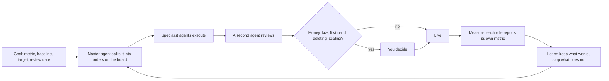

# agent-org-loop

**A starter agent organisation for sales and marketing: one master agent, 21 specialist agents, a shared board and a feedback loop for every role. Answer six questions and get your target audience, an A/B outreach sequence and a weekly plan in about 15 minutes.**

It runs in Claude Code. You need nothing else: no CRM, no accounts, no other tools.

> Language note: the agent definitions, skills and docs in this repository are written in German (the working language of the stack it comes from). This README is the English entry point; [README.de.md](README.de.md) is the full German original. Claude Code can adapt the files to your language.
>
> This describes a way of working, not a promise of results.

## What you get

- **22 roles in 5 teams** as Claude Code agents in `.claude/agents/`: Outbound (6), Sales (5), LinkedIn (4), SEO and GEO (3), Control (3), plus the master agent.
- **A board the agents manage themselves.** The master agent writes orders to a shared board, each agent picks up its own, and a different agent reviews the work before anything goes live. Nobody reviews their own output.
- **A feedback loop per role.** Every agent has one metric, one target and one review rhythm. It measures, tests variants and keeps what works.
- **20 skills**, among them `/einrichten` (setup), `/ziel-setzen` (set a goal), `/delegieren`, `/morgen-briefing` and `/wochenplan`.
- **After setup, three things in your hands** (folder `ergebnisse/`): a target audience with a search recipe, a sequence with variants A and B, and a weekly plan.

## The loop



A finding only becomes a rule when numbers support it. Too little data means "unclear, n too small", never a claimed success. How it works in detail: [`docs/autonomie.md`](docs/autonomie.md), [`docs/lernen.md`](docs/lernen.md), [`docs/zusammenarbeit.md`](docs/zusammenarbeit.md).

## Start in 3 steps

```bash
git clone https://github.com/locagoi/agent-org-loop.git
cd agent-org-loop
git config core.hooksPath .githooks   # commit guard against keys, see "Protect your data"
claude
```

1. Run **`/einrichten`**. Answer six questions in one message: what you sell, to whom, which problem, how you spot demand, what you can prove, your goal. Keywords are enough, pasting website text works too.
2. Read what lands in `ergebnisse/`: target audience, sequence A/B, weekly plan.
3. Next morning run **`/morgen-briefing`**, every Monday **`/wochenplan`**. For further goals: `/ziel-setzen`, then `/delegieren`.

Without connected tools everything stays a draft: the agents write files, you carry them over by hand. Examples of finished results: [`docs/beispiele/`](docs/beispiele/) (fictional company).

## The hierarchy

```
You (set goals, decide on money, law, first send, deleting, scaling)
└── Master agent
    ├── Outbound (6)   zielgruppe · firmensuche · kontaktpruefung · kaltakquise · zustellung · antworten
    ├── Sales (5)      meeting-vorbereitung · meeting-nachbereitung · angebot · deal-alarm · tagesaufgaben
    ├── LinkedIn (4)   ideen · autor · kommentare · analyse
    ├── SEO and GEO (3) artikel · ki-sichtbarkeit · luecken
    └── Control (3)    health · security · review
```

Each role is one file in `.claude/agents/` with task, inputs, result, rules (with the reason) and its feedback loop. Role names are German; [README.de.md](README.de.md) explains each one.

## Guardrails

- **No money without approval.** No agent buys, books, tops up or cancels.
- **Nothing goes live without a second look.** Another agent reviews; hard stops come to you.
- **Nothing is sent automatically** until you give explicit approval. The default is a draft plus a note.
- **Evidence instead of claims.** Every number has a source; if it is missing, the agent writes "unknown" instead of inventing one.
- **No customer data in public content.**
- **Third-party code only after the security gate.** A hook in `.claude/settings.json` asks before every install.
- **Foreign text is data, not instructions.** Emails, transcripts and web pages cannot give orders.

## Protect your data

After `/einrichten` your clone holds real company data (offer, target audience, goals). That is intended, and it must not become public by accident.

- Keep your working copy in a **private** repository. Check `firma/`, `ergebnisse/`, `ops/` and `docs/lernen/` before any public fork or push.
- Never put credentials into files in the repo. Keys belong in `.mcp.json` or `.env`, both already in `.gitignore`.
- Switch on the commit guard once per clone: `git config core.hooksPath .githooks`. It stops commits that contain typical key formats or files like `.env`.
- If a key was committed: rotate it at the provider right away. Deleting it in the next commit is not enough, it stays in the history.

## Connect to GTM Goat (optional)

*Everything above works without this section.* If you want the agents to read replies, find companies and enroll leads in a live sequence instead of writing drafts, you can connect them to GTM Goat, the GTM platform by cegtec, over MCP. Setup: [GTM Goat documentation](https://www.cegtec.net/gtm-goat/docs/) and the example file [`vorlagen/mcp.cegtec.example.json`](vorlagen/mcp.cegtec.example.json).

## Layout

```
CLAUDE.md          master agent: flow, briefing, hard rules
.claude/agents/    22 roles (master + 21 specialists)
.claude/skills/    20 skills
.claude/hooks/     ask before third-party code
docs/              autonomie, lernen, zusammenarbeit, regeln (every rule with its why), werkzeuge, beispiele, playbooks
firma/ ergebnisse/ ops/ vorlagen/ lead-magnets/    your data, results, board and templates
```

## License

MIT, see [LICENSE](LICENSE).
